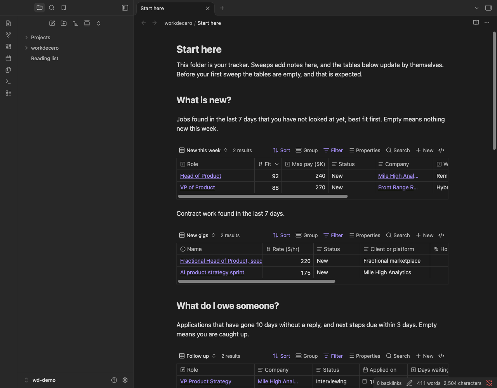

# workdecero

A Claude Code plugin that runs weekly job, contract and networking sweeps from your own profile and keeps the results in your Obsidian vault.

**Under construction.** Setup works. The sweeps themselves are still being built.

## Install

In Claude Code:

```
/plugin marketplace add madecero/workdecero
/plugin install workdecero@workdecero
```

Or from a terminal:

```
claude plugin marketplace add madecero/workdecero
claude plugin install workdecero@workdecero
```

Then start a new session and run `/workdecero:setup`.

## Setup

`/workdecero:setup` takes about 15 minutes. It reads your resume, asks a dozen or so short questions (what you want, where, what to leave out, how much to show you, which Obsidian vault), shows you a plain-language summary, and only then saves anything. Stop at any point before that and nothing has changed on your computer. Run it again later to change an answer.

Your answers stay in a file on your computer. Sweeps search the public web. Nothing is ever applied for, sent or posted for you.

While this repository is private you need read access to it and working git credentials for GitHub (an SSH key, or `gh auth login` followed by `gh auth setup-git`).

## Update

```
claude plugin marketplace update workdecero
claude plugin update workdecero@workdecero
```

Restart Claude Code (or run `/reload-plugins`) to pick up the new version.

## Where your data lives

Nothing personal is stored in this repository or in the plugin folder.

| What | Where | Notes |
| --- | --- | --- |
| Profile and local source map | `~/.config/workdecero/` | Location can be overridden. Untouched by updates and by uninstall. |
| Trackers (postings, contracts, groups, events, people, companies) | Your Obsidian vault | Plain Markdown notes that you own. |
| Setup draft | `~/.cache/workdecero/` (`setup-answers.json`, `setup-state.json`) | Temporary. Holds your answers only while setup is running, in a folder only you can open, and is deleted when setup is saved or cancelled. |
| Cache | The plugin data folder managed by Claude Code | Safe to lose. Removed when the plugin is uninstalled. |

## Your profile

One file, `~/.config/workdecero/profile.yaml`, holds what you are looking for, where, what to leave out and where your trackers live. Setup will write it for you. Set `WORKDECERO_HOME` to keep it in another folder.

See [examples/profiles](examples/profiles) for three complete examples, and [engine/profile.schema.json](engine/profile.schema.json) for every setting. To check a profile:

```
python3 engine/wdprofile.py validate path/to/profile.yaml
```

## Your tracker

Trackers are plain notes in your Obsidian vault, with table views that update as you work. Everything stays in one folder, and your own writing in a note is never touched. See [trackers/README.md](trackers/README.md) for the layout, the promises the plugin keeps, and how to build a demo vault to look around.



## What workdecero is allowed to do without asking

Claude Code normally asks before it runs a command or writes a file. Setup is a conversation with many steps, and being asked a dozen times would make it unusable. So while this plugin is enabled, a small hook (`hooks/allow_helper.py`) approves exactly the following, and nothing else:

| What | Exactly |
| --- | --- |
| Run the setup helper | `python3 "<plugin folder>/skills/setup/scripts/setup_tool.py"` followed by one of: `status`, `takeover`, `fields`, `save`, `read-resume`, `check-vault`, `preview`, `preview-details`, `preview-file`, `write`, `cancel`, `import-connections`. Nothing may follow the subcommand |
| Write one temporary file | `~/.cache/workdecero/setup-answers.json`, and only while that folder is a real folder that you own and nobody else can open |

What that means in practice:

* The helper takes no arguments, so an approved command cannot be aimed at another file. It reads and writes your profile, your local map, the workdecero folder in your vault, and the temporary folder above. It does nothing unless a setup run is open.
* Any other command, any extra word on those command lines, any other file: Claude Code asks you as usual. The hook never blocks anything and never approves anything it does not recognise in full.
* One thing still asks on purpose: reading your resume if it is a PDF outside the folder you started in. That is your file, so you get to say yes.
* The approval applies in any conversation while the plugin is enabled, not only during setup. To turn it off, disable the plugin: `claude plugin disable workdecero@workdecero`.

## What it does not do

Research only. It never applies, messages, registers or creates accounts for you.

## Requirements

Claude Code and `python3` 3.9 or newer (the version macOS ships). No other installs.

## Contributing

See [CONTRIBUTING.md](CONTRIBUTING.md).

## License

MIT. See [LICENSE](LICENSE).
